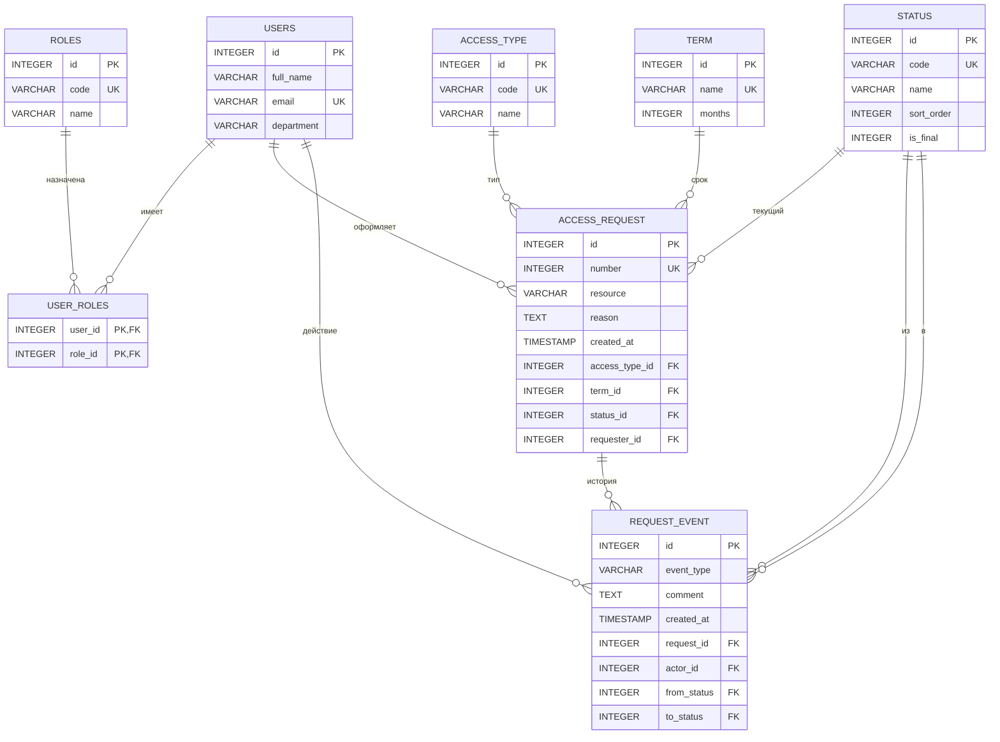

# ER-диаграмма Access Request

Диаграмма по разделам §3, §4, §5 документации. Текстовое описание — внизу файла.

## Mermaid



## Схема текстом

**USERS** — сотрудник организации. Связан с ACCESS_REQUEST как заявитель и с REQUEST_EVENT как автор действия.

**ROLES** — справочник: Сотрудник, Согласующий, Администратор доступа (§3). Связьmany-to-many через **USER_ROLES**, так как один пользователь может совмещать роли.

**ACCESS_TYPE** — справочник: Чтение / Запись / Администрирование (§4).

**TERM** — справочник срока: 1 месяц / 3 месяца / 6 месяцев / Бессрочно. Для бессрочного `months = NULL`.

**STATUS** — справочник статусов: Новый / На согласовании / Одобрен / Отклонён / Выполнен. Поля `sort_order` и `is_final` описывают правило §5: переходы только вперёд, после «Выполнен» изменение запрещено.

**ACCESS_REQUEST** — основной объект (§4). Номер уникален, основание проверяется на длину ≥ 15 символов (CHECK-ограничение), дата создания проставляется автоматически.

**REQUEST_EVENT** — история переходов. Хранит, кто и когда согласовал или выдал доступ (§1, §5), включая причину отклонения.

## Связи

| Отношение | Тип | Пояснение |
|---|---|---|
| USERS ↔ ROLES | M:N | через USER_ROLES |
| USERS → ACCESS_REQUEST | 1:N | один сотрудник — много запросов |
| ACCESS_TYPE → ACCESS_REQUEST | 1:N | справочник типа доступа |
| TERM → ACCESS_REQUEST | 1:N | справочник срока |
| STATUS → ACCESS_REQUEST | 1:N | текущий статус запроса |
| ACCESS_REQUEST → REQUEST_EVENT | 1:N | история согласований и выдачи |
| USERS → REQUEST_EVENT | 1:N | автор действия |
| STATUS → REQUEST_EVENT | 1:N (×2) | статус «до» и «после» перехода |

## Переходы статусов (§5)

```
Новый → На согласовании → Одобрен → Выполнен
                        ↘ Отклонён
```

Каждый переход пишется в `REQUEST_EVENT` с `from_status`, `to_status`, `actor_id`.
